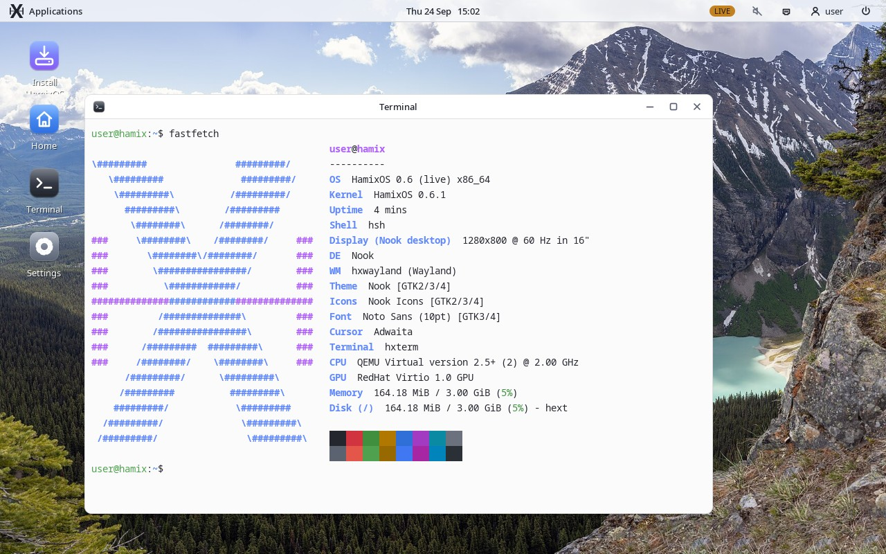
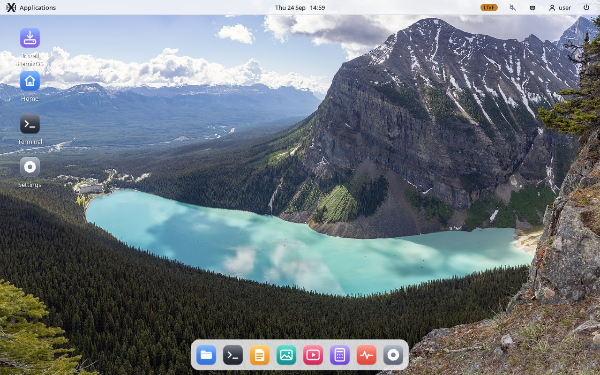
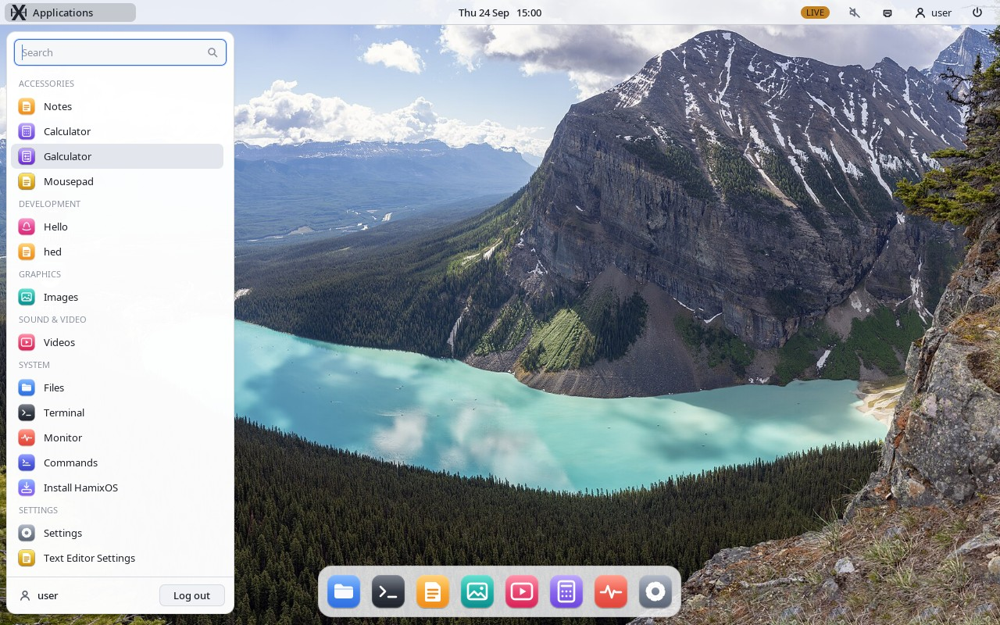
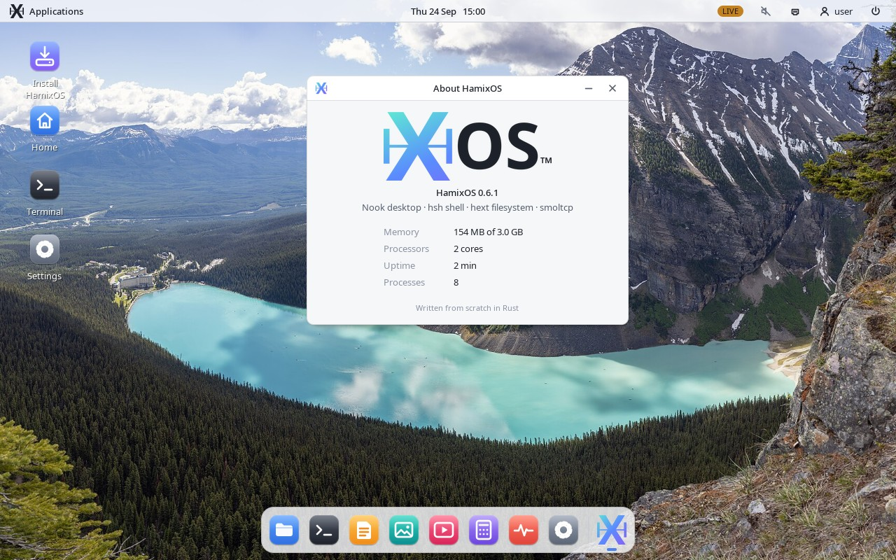

<div align="center">


# HamixOS

**A desktop operating system written from scratch in Rust — its own kernel, its own shell, its own desktop, and room for your Linux apps.**

[](LICENSE)


[Screenshots](#-screenshots) ·
[Features](#-features) ·
[Get started](#-get-started) ·
[Build](#-build-from-source) ·
[Hardware](#-hardware) ·
[Docs](#-documentation)



</div>

---

## 📸 Screenshots

<table>
  <tr>
    <td width="50%"></td>
    <td width="50%"></td>
  </tr>
  <tr>
    <td align="center"><b>Nook</b> in the light style</td>
    <td align="center">Compact application menu, grouped by category</td>
  </tr>
  <tr>
    <td width="50%"></td>
    <td width="50%"></td>
  </tr>
  <tr>
    <td align="center"><b>About HamixOS</b> with the new logo</td>
    <td align="center"><b>Nook Icons</b> — one style for system and Linux apps</td>
  </tr>
</table>

## ✨ Features

<table>
<tr>
<td width="50%" valign="top">

### 🧠 Own kernel
- 64-bit kernel in `no_std` Rust, SMP, preemptive threads
- **hext** — its own journaled filesystem
- **hxinit** — parallel boot with a clear status for every unit
- Loadable **driver modules** with a stable KPI, W^X, per-module memory budget and a watchdog

</td>
<td width="50%" valign="top">

### 🪟 Nook desktop
- Compositing window manager with snapping, animations and a dock
- Light and dark styles, wallpapers, notifications, Wi-Fi and sound menus
- Application menu built from `.desktop` files — installed apps show up by themselves
- **Nook Icons** theme shared with GTK apps

</td>
</tr>
<tr>
<td valign="top">

### 🐧 Linux apps
- Runs unmodified Alpine Linux programs through the Linux ABI layer
- Wayland (`hxwayland`) and X11 (Xwayland) for GTK and Qt apps
- **pantry** package manager: `pantry install mousepad`
- Tested: LibreOffice, Telegram Desktop, Chromium, Thunar, Mousepad, fastfetch, btop

</td>
<td valign="top">

### 🧰 Native apps
- **bash** 5.2 built natively on hxlibc as the system shell; HamixOS commands (`sudo`, `fetch`, `lsblk`, `startx`, ...) are separate programs
- Terminal, Files, Notes, Images, Videos (own H.264/AAC decoder), Calculator, Monitor, Settings
- Graphical installer with a real bootloader setup
- Networking on smoltcp: Ethernet, Wi-Fi (WPA2), DHCP, DNS

</td>
</tr>
</table>

## 🚀 Get started

1. Download `hamix_os.iso` from the [Releases](https://github.com/mardner4ik/HamixOS/releases) page (or [build it](#-build-from-source)).
2. Write it to a USB stick (`dd`, [Ventoy](https://www.ventoy.net) or balenaEtcher) and boot it, or run it in QEMU:

```bash
qemu-system-x86_64 -M q35 -m 2G -smp 2 -enable-kvm \
    -cdrom hamix_os.iso -boot d \
    -device virtio-vga -nic user,model=e1000
```

3. Log in and start the desktop:

| account | password |
|---------|----------|
| `user`  | `user`   |
| `root`  | `hamix`  |

```
user@hamix:~$ startx
```

4. Double-click **Install HamixOS** on the desktop to put the system on a disk.

### Boot firmware

The x86_64 live ISO contains BIOS boot via `hxboot` and a UEFI El Torito entry via GRUB EFI.
The image structure is verified; booting it under OVMF and on hardware is still pending. UEFI boot
through Ventoy has not been verified; writing the ISO directly to a USB stick with `dd` currently
provides the BIOS path. Native `hxboot-efi` and UEFI installation to a disk are still in progress.
The aarch64 port has its own EFI stub and ESP image.

To start the x86_64 ISO in UEFI mode with QEMU, pass an OVMF firmware image:

```bash
cargo xtask run -- -bios /usr/share/edk2/x64/OVMF.4m.fd
```

> [!TIP]
> Install Linux software with `pantry install <package>` — the package appears in the application menu with its icon a few seconds later.

## 🛠 Build from source

<details>
<summary><b>Requirements</b></summary>

- Linux: Rust nightly with `rust-src` (rustup); OpenBSD or any host without rustup: the packaged stable
  `rustc`/`cargo` -- xtask enables nightly features with `RUSTC_BOOTSTRAP` and downloads `rust-src` itself
- `clang`, `ld.lld`, `llvm-objcopy`, `curl`, `xz`, `mkfs.vfat`, `mmd`, `mcopy`, and `grub-mkstandalone`
  (the hxboot BIOS and GRUB UEFI entries in the ISO)
- optional: `grub-mkrescue` and `xorriso` for a GRUB-built ISO (`--loader grub`)
- OpenBSD: `doas sh tools/openbsd/tune-build.sh` once (login class, SMT, `noatime`, packages)
- for regenerating the desktop artwork: Python 3 with Pillow and numpy, `rsvg-convert`, the Noto fonts

</details>

```bash
git clone https://github.com/mardner4ik/HamixOS.git
cd HamixOS
cargo xtask build                           # kernel, modules, userland, live image, out/hamix_os.iso
cargo xtask build --profile core            # hamix-core: the native system without the Linux layer
cargo xtask build --arch aarch64            # or riscv64
cargo xtask run                             # boot the image in QEMU
cargo xtask test                            # boot tests from tests/boot in QEMU
cargo xtask lint-layers                     # nothing native may depend on layers/linux
python3 tools/nook-assets/generate.py       # icons, Nook Icons, fonts, wallpapers
```

Everything generated lands in `out/`. `--extra DIR` (or `HAMIX_EXTRA=DIR`) copies a
directory on top of the live root filesystem — handy for videos, test files or
prebuilt Linux packages. `./build.sh` is a thin wrapper around `cargo xtask build`.

## 💻 Hardware

| | Supported |
|---|---|
| **Graphics** | Intel GMA X3000/X3100/4500MHD (`intel-gma`), Intel HD 2000 – UHD 630 (`intel-display`), virtio-gpu, any UEFI/VBE framebuffer |
| **Network** | Intel e1000 and e1000e (I217/I218/I219), Marvell Yukon-2, Qualcomm Atheros AR9285 Wi-Fi, virtio-net |
| **Storage** | AHCI SATA, IDE, virtio-blk |
| **Input** | PS/2 keyboard and touchpad, USB HID over xHCI/UHCI, virtio-input |
| **Sound** | Intel HDA, AC'97 |

Tested on a Samsung R428 and a Lenovo ThinkPad L560, and in QEMU on x86_64, aarch64 and riscv64.

## 📚 Documentation

| | |
|---|---|
| [INSTALL](docs/guides/INSTALL.md) | installing to a disk and the boot process |
| [HSH](docs/guides/HSH.md) · [COMMANDS](docs/guides/COMMANDS.md) | the shell and the command registry |
| [HEXT](docs/architecture/HEXT.md) · [HXINIT](docs/architecture/HXINIT.md) | filesystem and system startup |
| [XORG](docs/architecture/XORG.md) | Nook and the window protocol |
| [MODULES](docs/architecture/MODULES.md) · [KPI_ROADMAP](docs/roadmap/KPI_ROADMAP.md) | driver modules and the kernel programming interface |
| [NETWORK](docs/architecture/NETWORK.md) · [AUDIO](docs/architecture/AUDIO.md) · [VIDEO](docs/architecture/VIDEO.md) | networking, sound, video |
| [LINUXULATOR](docs/architecture/LINUXULATOR.md) · [PANTRY](docs/guides/PANTRY.md) | running Linux programs and installing packages |
| [PORTING](docs/guides/PORTING.md) | the aarch64 and riscv64 ports |
| [CHANGES](CHANGES.md) | release notes |

## 🗂 Repository

```
kernel/          the kernel (see "Kernel" below)
modules/         loadable driver modules (Rust and Linux C drivers)
sdk/             kernel module SDKs (hamix_kpi, hamix_linuxkpi) and the ABI headers
hxlibc/          the C library: the full mlibc source tree with sysdeps/hamix (builds libhxc.so, ld.hx),
  rust/          Rust side of the libc: hxlibc-sys (FFI to libhxc.so + HamixOS call numbers)
crates/          portable Rust libraries with no OS dependency, usable by the kernel, tools and any OS:
                 hext (filesystem format), hxvt (terminal emulator core), wlan (802.11), hxproto (display
                 protocol + POSIX client), hxtoolkit (UI toolkit), vellum (2D drawing), imago (PNG, JPEG, GIF, BMP, ICO, QOI, TGA, PNM, SVG), codecs
userland/        HamixOS's own programs and system libraries, one folder per program or library:
  apps/          Nook apps (hxterm, hxfiles, hxnotes, ...)
  core/          commands: hxutils, pantry, hxctl, hed
  desktop/       hxserver (Nook), hxsettings, hxwayland
  services/      hxsvc (PID 1), hx-authd, hxsound
  libs/          libraries that talk to HamixOS: hxstd (runtime), hxport, hxclient, libhxproto (C .so)
ports/           third-party software built from upstream sources (HXBUILD recipes), same roles:
  apps/          foot, dillo
  core/          bash, busybox, curl, lua, sqlite
  desktop/       Enlightenment, Xwayland, xkbcomp
  services/      dbus
  libs/          Unix libraries: glib, cairo, gtk3, mesa, wayland, libX11, ...
vendor/          third-party Rust crates kept in the tree: smoltcp, rust_h264, shiguredo_mp4
layers/linux/    the Linux compatibility layer: Alpine root (/linux), adapters, overlay
data/            files of the native image: overlay (icons, wallpapers, themes, /etc), GRUB menu
tests/           boot tests run by `cargo xtask test`, C tests of hxlibc and the ports
tools/           xtask, mkhext, asset generator, KPI helpers
docs/            documentation, see docs/README.md
out/             build output (not in git)
```

Layering, as in Redox: `hxlibc` (like relibc) is the only way programs reach the kernel;
`userland/libs` (like libredox) wraps it for Rust; `crates/` never call the OS directly.

### Kernel

```
kernel/src/
  arch/          x86_64 (GDT, IDT, LAPIC, IOAPIC, ACPI, SMP), aarch64, riscv64
  memory/        frames, paging, kernel heap, vmalloc
  task/          processes, threads, scheduler, ELF loading, pipes, IPC
  syscall/       the POSIX system call layer: table.rs (numbers + dispatch), base (files),
                 process, signal (+ sigframe/), misc, special; ext/ = HamixOS extensions
  linux/         the Linux personality: syscalls.rs (asm-generic numbering), paths.rs and
                 loader.rs (the /linux namespace), mod.rs (enable/disable)
  fs/            VFS, hext, iso9660, tar, procfs, epoll
  net/           TCP/IP (smoltcp), AF_UNIX, sockets, AF_INET glue, netlink
  tty/           consoles and VTs (vt.rs), ptys (pty.rs), termios
  drivers/       PCI, storage, input, USB, video (+ DRM), audio, IRQ routing
  module/        loadable modules: ELF loader, relocations, the KPI
  hxinit.rs      the ordered boot units shown on screen
```

## 📄 License

HamixOS is released under the **GNU GPLv3**. Bundled third-party code keeps its
own license: smoltcp (0BSD), the Linux e1000e driver (GPL-2.0), Atheros HAL
tables (ISC), rust_h264 (MIT/Apache-2.0), shiguredo_mp4 (Apache-2.0), the
Symphonia AAC decoder (MPL-2.0). Wallpaper photographs are from Wikimedia
Commons, credits in `data/overlay/usr/share/wallpapers/CREDITS`.

<div align="center">
<sub>Made with 🦀 and Rust</sub>
</div>
